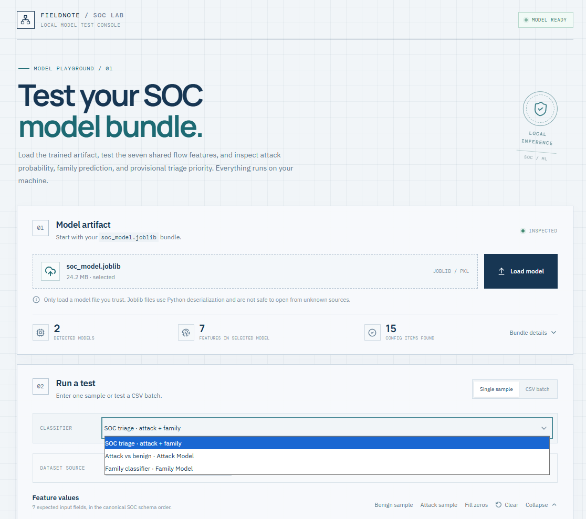
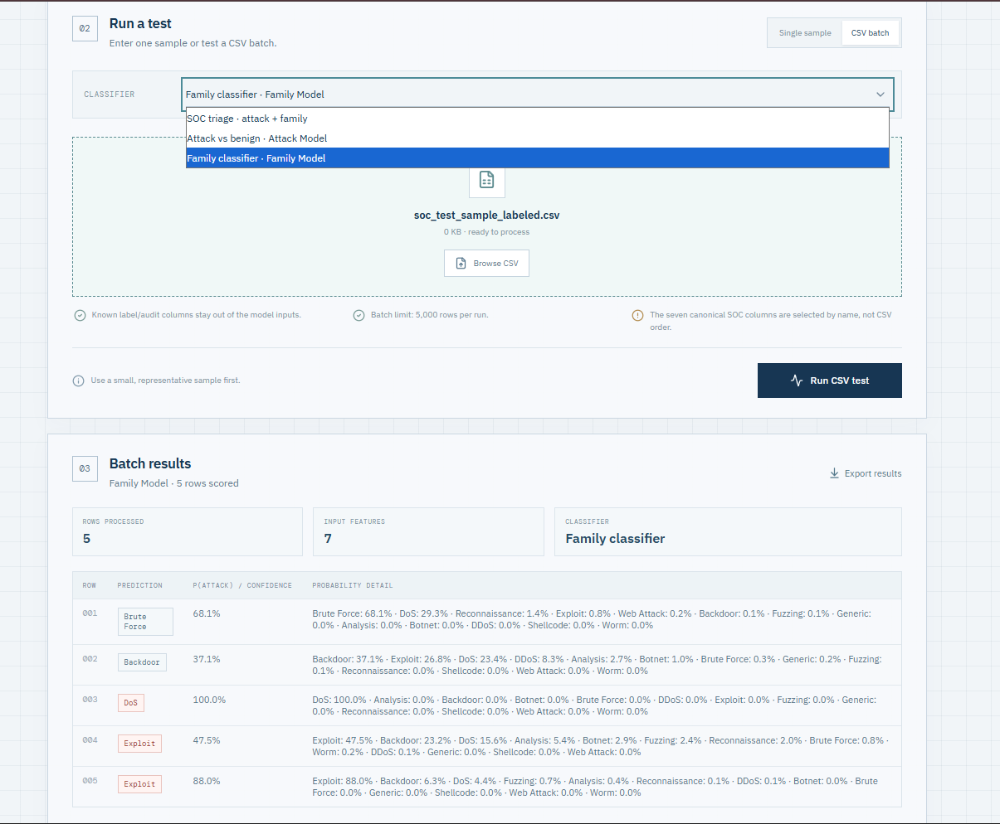

# SOC Model Tester
### A Local Machine Learning Interface for Network Intrusion Triage

SOC Model Tester is a local web application for loading and testing a saved machine learning artifact, `soc_model.joblib`, developed as part of a multi-dataset Network Intrusion Detection and SOC triage project.

The application provides a simple interface for testing network-flow records, distinguishing benign traffic from potential attacks, classifying predicted attack families, and reviewing triage priorities. It supports individual predictions, synthetic test samples, and CSV batch evaluation.

The project is designed for offline model experimentation and demonstration. It does not capture live network traffic or replace a production intrusion detection system.

## Table of Contents

- [Overview](#overview)
- [Screenshots](#screenshots)
- [Technology Stack](#technology-stack)
- [System Architecture](#system-architecture)
- [Model Input Schema](#model-input-schema)
- [Features](#features)
- [Getting Started](#getting-started)
- [Running the Application](#running-the-application)
- [Using the Interface](#using-the-interface)
- [Prediction and Triage Logic](#prediction-and-triage-logic)
- [CSV Evaluation](#csv-evaluation)
- [Model Compatibility and Preprocessing](#model-compatibility-and-preprocessing)
- [Project Structure](#project-structure)
- [Limitations and Security](#limitations-and-security)

## Overview

The project addresses a practical SOC workflow: examine a network-flow record, estimate whether its characteristics resemble benign or attack traffic, and prioritize suspicious records for further investigation.

The saved model artifact may contain a binary classifier, an attack-family classifier, benign-feature percentile information, and severity-related configuration.

The application loads the available components and provides a browser-based interface for testing the model without requiring users to interact directly with the Python code.

**Dataset context:** The model development work uses aligned network-flow features from CIC-IDS2017 and UNSW-NB15. These datasets differ in traffic distributions and attack categories, making per-dataset evaluation important.

## Screenshots

### 1. Model Upload and Configuration

Upload the serialized model artifact and inspect the model-loading status.

<!-- Screenshot 1: Save your model upload screenshot as docs/images/model-upload.png -->



### 2. Prediction and Triage Results

Review the predicted traffic label, available probability scores, attack-family classification, and applicable triage priority.

<!-- Screenshot 2: Save your prediction results screenshot as docs/images/prediction-results.png -->



To add these screenshots, create a `docs/images/` directory in the repository and save the corresponding images using the filenames shown above. The images will appear automatically on GitHub once the files are committed.

## Technology Stack

| Component | Technology | Purpose |
|---|---|---|
| Frontend | React | Interactive, single-page user interface |
| Frontend tooling | Vite | Development server and frontend build tooling |
| UI development | JavaScript, HTML, CSS | Forms, input validation, layout, and results presentation |
| Backend | Python | Model loading, feature preparation, inference, and evaluation |
| Web API | Flask | Handles frontend requests and model operations |
| Machine learning | scikit-learn 1.6.1 | Compatible estimator and pipeline environment |
| Model persistence | joblib | Loads the serialized model artifact |
| Data input/output | CSV | Batch prediction, optional evaluation, and result export |

The frontend and backend run as separate local development services. React communicates with Flask to request model inspection and prediction operations.

## System Architecture

```text
                   SOC Analyst
                        |
                        v
              React + Vite Frontend
                localhost:5173
                        |
                        | HTTP requests
                        v
                 Flask Backend
               127.0.0.1:5000
                        |
                        v
                Model Artifact
                 soc_model.joblib
                        |
             +----------+----------+
             |                     |
             v                     v
       Binary Classifier    Family Classifier
       BENIGN / ATTACK      Attack Category
             |
             v
       Triage Assessment
             |
             v
       Results and CSV Export
```

The family classifier is used for records predicted as `ATTACK` in the combined SOC triage workflow, when the required classifier is available in the bundle.

The application is intended for local experimentation. It does not automatically block traffic or perform live packet inspection.

## Model Input Schema

The application uses the following seven shared features from the notebook. CSV columns are selected by name rather than by their position.

| Feature | Description | Expected representation |
|---|---|---|
| `flow_duration_seconds` | Duration of the network flow | Numeric |
| `src_packets` | Number of packets sent from the source | Numeric |
| `dst_packets` | Number of packets sent from the destination | Numeric |
| `src_bytes` | Bytes sent from the source | Numeric |
| `dst_bytes` | Bytes sent from the destination | Numeric |
| `src_mean_packet_bytes` | Average source packet size in bytes | Numeric |
| `dst_mean_packet_bytes` | Average destination packet size in bytes | Numeric |

The following columns may be present in evaluation datasets but are **not model input features**:

- `is_attack`
- `attack_category`
- `dataset_source`
- `original_label`
- `binary_label`

These fields provide ground-truth labels or audit information. Keeping them out of the prediction input helps avoid label leakage.

## Features

### Model Loading and Inspection

- Upload a trusted `.joblib`, `.pkl`, or `.pickle` artifact.
- Inspect common dictionary or list model bundles for recognizable estimator objects.
- Identify likely binary and family classifiers when their names or metadata provide sufficient clues.
- Display discoverable benign percentile information and severity configuration.
- Report model-loading or compatibility problems through the interface.

### Single-Record Prediction

- Enter network-flow feature values manually.
- Populate the form using available example records.
- Generate a synthetic random sample for a quick inference test.
- Run a direct prediction against a selected classifier.
- Run the combined SOC triage workflow.
- Display available predicted labels and probability scores.

### CSV Batch Testing

- Upload a CSV containing the seven required feature columns.
- Handle reordered input columns by selecting features by name.
- Process up to 5,000 records per batch.
- Generate 25 synthetic test rows directly in the interface.
- Export prediction results as a CSV file.
- Calculate evaluation metrics when supported ground-truth labels are present.

Synthetic samples are intended for testing the application workflow. They are not labeled observations from real network traffic and should not be used to claim model accuracy.

## Getting Started

### Prerequisites

Install the following software before running the application:

- **Python 3.12** for the backend environment.
- **Node.js LTS**, which includes npm, for the frontend.
- **Visual Studio Code** or another code editor.
- A trusted `soc_model.joblib` artifact for actual model testing.

The notebook environment used scikit-learn 1.6.1. The backend requirements pin this version to help maintain compatibility with the saved artifact.

Verify that Python and Node.js are available from a terminal:

```powershell
python --version
node --version
npm.cmd --version
```

If a command is not recognized, install the corresponding software and reopen the terminal.

### Open the Project

Extract the repository into a normal directory and open that directory in Visual Studio Code.

For example:

```powershell
cd C:\Users\YourUsername\Desktop\soc-model-tester
```

Replace the example path with the actual location of your project.

Open two separate terminals in VS Code using **Terminal → New Terminal**. The first will run Flask and the second will run React.

## Running the Application

### Terminal 1: Set Up and Start Flask

From the project root, execute:

```powershell
cd backend
python -m venv .venv
```

Install the backend dependencies:

```powershell
.\.venv\Scripts\python.exe -m pip install --upgrade pip
.\.venv\Scripts\python.exe -m pip install -r requirements.txt
```

Start the backend:

```powershell
.\.venv\Scripts\python.exe app.py
```

The Flask service should be available at:

```text
http://127.0.0.1:5000
```

Keep this terminal open while using the application.

### Terminal 2: Set Up and Start React

Open a second terminal. If it starts in the project root, execute:

```powershell
cd frontend
npm.cmd install
```

Start the Vite development server:

```powershell
npm.cmd run dev
```

The frontend should be available at:

```text
http://127.0.0.1:5173
```

Open that address in your browser.

**Windows PowerShell note:** The `npm.cmd` commands can be used when PowerShell blocks `npm.ps1` because of its execution policy. This avoids changing the system-wide PowerShell security policy.

Both services must remain running during testing. Stop a service by pressing `Ctrl+C` in its terminal.

## Using the Interface

### Step 1: Load the Model

Open the application in your browser and select your trusted `soc_model.joblib` artifact using the model upload control. Click the model-loading action and check the status message.

The model must contain recognizable estimators or otherwise match the backend's supported bundle structure.

### Step 2: Run a Single Prediction

Select the desired classifier or the combined SOC triage workflow.

Use an example record, generate a synthetic random sample, or enter numeric values for the seven input features. Run the prediction and review the returned results.

### Step 3: Test a CSV

Choose CSV batch mode and upload a dataset containing the required feature columns.

Alternatively, use the interface's synthetic batch generator to create 25 rows for a quick functional test.

The input labels, when present, should remain separate from the model features. The application can use recognized ground-truth fields for evaluation after prediction.

### Step 4: Review and Export

Inspect the prediction results and any available evaluation metrics. Export the batch results to CSV when required.

A successful prediction confirms that the inference path ran. It does not, by itself, establish that the prediction is correct.

## Prediction and Triage Logic

The combined workflow uses the binary classifier to distinguish `BENIGN` from `ATTACK`. If the prediction is `ATTACK`, the family classifier may be used to estimate an attack category.

When an attack probability is available, the provisional triage policy follows these thresholds:

| Attack probability | Triage priority |
|---|---|
| \(P(\text{ATTACK}) < 0.50\) | `LOW_PRIORITY` |
| \(0.50 \leq P(\text{ATTACK}) < 0.85\) | `REVIEW` |
| \(P(\text{ATTACK}) \geq 0.85\) | `HIGH_PRIORITY_REVIEW` |

These are demonstration thresholds supplied by the project specification. They are not calibrated or validated operational rules.

The interface should not be interpreted as providing a validated severity score, incident confirmation, or automated response authorization merely because a record receives a high-priority result.

## CSV Evaluation

When a supported target label is available in the uploaded dataset, the application can report binary classification metrics, including:

- Accuracy
- Attack precision
- Attack recall
- F1-score
- True positives (TP)
- True negatives (TN)
- False positives (FP)
- False negatives (FN)

Evaluation is meaningful only when the ground-truth labels are correctly mapped and correspond to the same records being evaluated.

For reliable model assessment, use a held-out test set and examine results separately for CIC-IDS2017 and UNSW-NB15 where possible. Differences between datasets may expose domain shift that a single aggregate score can hide.

Do not interpret metrics calculated on training rows as independent test performance.

## Model Compatibility and Preprocessing

The notebook reports a prepared training matrix with standardized features, with means near zero and standard deviations near one.

This has an important implication: if the saved classifiers were trained on standardized inputs, prediction inputs must undergo the same fitted transformation.

The application checks for supported scikit-learn pipelines or separately bundled preprocessing objects when discoverable. If the expected preprocessing cannot be found, the backend may warn that raw values are being passed directly to the estimator.

In that situation, the model may still return a prediction, but the result should not be trusted until the training preprocessing workflow has been verified.

Before interpreting predictions, confirm that:

1. The saved bundle contains the intended binary and family classifiers.
2. The feature order and definitions match those used during training.
3. The fitted preprocessing is present and applied correctly.
4. The installed scikit-learn version is compatible with the serialized estimators.
5. The target classes and probability-column mappings are interpreted correctly.

Serialized scikit-learn models may not be compatible across arbitrary library versions. The pinned requirements reduce version mismatch risk but do not guarantee compatibility with every artifact.

## Project Structure

```text
soc-model-tester/
├── backend/
│   ├── app.py
│   ├── requirements.txt
│   ├── models/
│   └── uploads/
│
├── frontend/
│   ├── index.html
│   ├── package.json
│   └── src/
│
├── docs/
│   └── images/
│       ├── model-upload.png
│       └── prediction-results.png
│
├── install-tools.bat
├── start-windows.bat
├── check-tools.bat
└── README.md
```

The `models/` and `uploads/` directories may be created or used by the backend as required. The batch scripts are optional Windows convenience tools; the terminal walkthrough above explains how to run the project manually.

## Limitations and Security

- **Local testing only:** This project is an offline model-testing interface, not a production SOC platform or live network intrusion detection service.
- **Model trust:** Joblib and pickle-based formats can execute code during deserialization. Load only artifacts from trusted sources.
- **Preprocessing:** A prediction is not reliable unless the input transformation matches the training procedure.
- **Synthetic data:** Randomly generated records test application functionality, not real-world detection quality.
- **Evaluation:** Metrics depend on valid ground-truth labels and an appropriate test set.
- **Operational response:** An alert is a lead for investigation, not proof of an incident. The application should not automatically block traffic based on these demonstration thresholds.
- **Privacy:** Keep the development services on your local machine and avoid uploading confidential traffic records or sensitive datasets to public repositories.

## References

- [React Documentation](https://react.dev/)
- [Vite Documentation](https://vite.dev/guide/)
- [Flask Documentation](https://flask.palletsprojects.com/)
- [scikit-learn Documentation](https://scikit-learn.org/stable/)
- [joblib Persistence and Security Guidance](https://joblib.readthedocs.io/en/latest/user_guide/persistence.html)
- [Python Downloads](https://www.python.org/downloads/)
- [Node.js Downloads](https://nodejs.org/en/download)

---

**Project purpose:** Provide a transparent, reproducible local interface for exercising a saved network-intrusion model, inspecting its outputs, and supporting further model evaluation.